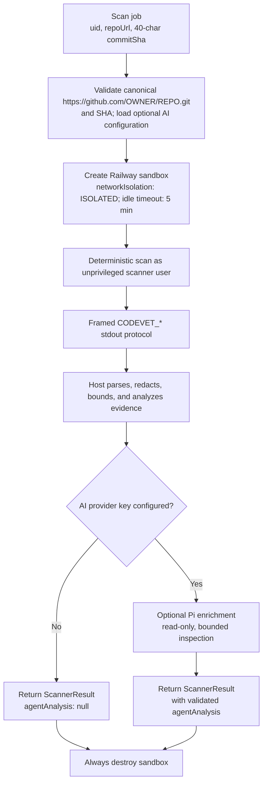
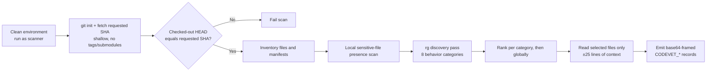
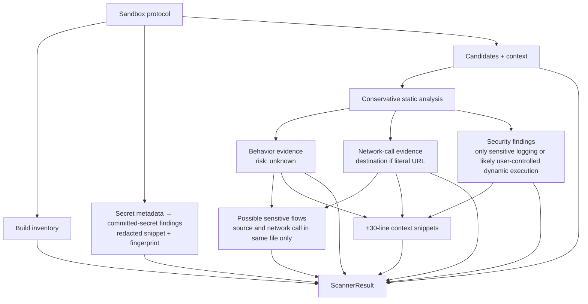
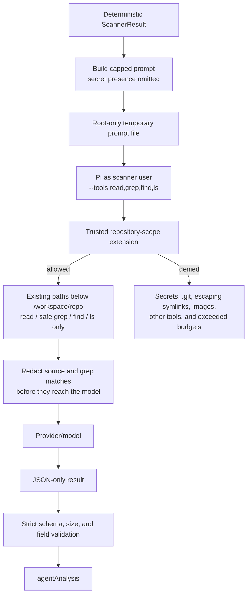

# `src/scan.ts` flow

`runScannerContainer(job)` scans one immutable GitHub commit in a short-lived Railway sandbox. Repository files are **data**, never commands to run.



## What is given to the sandbox

| Input / setup | Available where | Purpose |
|---|---|---|
| `JOB_UID`, validated `REPO_URL`, lowercase `COMMIT_SHA` | Deterministic scan command only, in a clean allowlisted environment | Identifies the job and exact revision to fetch. |
| Scanner image: `git`, `ripgrep`, Node/npm, CA certificates, and basic OS tools | Sandbox template | Inspection tools only. Pi is installed once during image build from a version- and integrity-pinned tarball; no repository dependency is installed. |
| `/workspace` owned by user `scanner` (UID 10001) | Sandbox | Checkout and inspection workspace. The deterministic scan runs as this non-root user. |
| Public egress in Railway `ISOLATED` network mode | Sandbox | Allows Git HTTPS fetch and, if enabled, the provider request made by Pi. It cannot use the worker's private network. |
| Optional AI API key | **Not** a sandbox runtime variable | Passed only to the separate Pi process through a cleared environment, after deterministic scanning. |

The URL must be an HTTPS, credential-free, query-free canonical `github.com/<owner>/<repo>.git` URL, and the SHA must be 40 hexadecimal characters.

## Inside the sandbox: deterministic scan



### 1. Safe checkout

The sandbox runs `git` with hooks, credential helpers, global/system config, submodules, and Git LFS smudging disabled. It fetches only the requested commit with `--depth=1`, checks it out detached, verifies `HEAD`, then removes the request-controlled URL and SHA from the environment.

It does **not** run repository scripts, hooks, package managers, dependency installation, builds, tests, binaries, or application code.

### 2. Inventory

The scan counts all non-`.git` files and emits up to 5,000 file paths. It emits up to 100 known manifests, each truncated to 20 KB. This later produces:

- languages inferred from extensions;
- package managers;
- frameworks matched from manifest text;
- likely entrypoints, including `package.json` `main`, `module`, and `bin` fields.

### 3. Sensitive-file presence scan

For conventional sensitive files (`.env*`, secret/credential config names, and key/certificate extensions), a local Node script reads at most 1 MB per file and finds up to 250 apparent values.

It emits only:

```text
path + line + secret type + ephemeral HMAC-SHA-256 fingerprint
```

It never emits the secret value or sensitive-file contents. The HMAC key is generated inside the sandbox and is not emitted.

### 4. Discovery and context

`ripgrep` searches source/configuration text for these categories:

- keyboard input, microphone access, clipboard access;
- sensitive system access;
- external HTTP/network calls;
- process execution;
- credential handling;
- tracking/telemetry.

Discovery excludes `.git`, dependencies/build output, `.env*`, and conventional secret/key files. It scans text files up to 5 MB and retains bounded, ranked leads per category. Matches are scored to prefer concrete APIs, source expressions, entrypoints, and non-test source files. Dedicated security and supply-chain categories cover likely injection, traversal, unsafe deserialization/JWT/crypto/CORS, install hooks, risky workflows, download-and-execute behavior, reverse shells, obfuscation, persistence, mining, and destructive commands.

The scanner then selects at most 250 total candidates and at most 40 per category. Only those selected regular files (up to 1 MB) are read for context, and it emits selected match lines plus up to ±25 lines, with each line capped at 500 characters.

## After the deterministic command

`parseScannerOutput()` treats the sandbox stdout protocol as untrusted input. It decodes only recognized `CODEVET_*` records, applies limits, and redacts sensitive-looking values. It then:



Important interpretation rules:

- API presence is normally behavior evidence, **not** a vulnerability.
- Process execution becomes a high-severity finding only when a likely user-controlled value is passed to a shell/dynamic-code interpreter.
- Credential input is normal behavior; a finding requires a sensitive logging call.
- A `candidateFlow` is explicitly a **possible** flow. Correlation uses same-file evidence plus direct and short transitive import relationships between selected evidence files; it does not prove data transfer.

## Optional Pi analysis in the same sandbox

Pi runs only after the deterministic protocol has been parsed, so Pi output cannot alter that protocol. If no provider credential is configured, this stage is skipped.



Pi's tool extension enforces, rather than merely requests:

- only `read`, safe `grep`, `find`, and `ls`; no repository extensions, skills, prompt templates, approval, or context files;
- containment in `/workspace/repo`, existing targets only, and no `.git`, secret/config/key/certificate files, escaping symlinks, or images;
- a custom grep implementation that canonicalizes every result path, redacts every match, skips generated/dependency directories, and caps both matches and returned bytes;
- at most 30 LLM turns, 80 tool calls, 4 MB of model-visible repository content, 200 KB per file, and 250 list results; grep additionally returns at most 200 matches / 32 KB per call;
- a 300-second process timeout and 256 KB combined output limit.

The model receives capped deterministic findings and repository metadata (at most 64 KB), plus at most eight small, high-priority metadata/entrypoint/source files (at most 256 KB). These files are only an initial lead set, not a fixed sample or coverage boundary. Pi can traverse the full non-sensitive checkout and dynamically choose further files by following imports and data flows; aggregate byte, call, turn, file-size, and execution limits still apply. The final result must be submitted through the terminating `codevet_report` tool and is rejected if that tool was not used. Invalid, failed, timed-out, or oversized model output becomes a non-fatal `agentAnalysis` with `failed` or `timeout` status; deterministic results remain available.

## What `runScannerContainer` provides

The returned `ScannerResult` contains:

| Field | Contents |
|---|---|
| `commitSha` | Verified checked-out SHA, or `null` if the protocol did not provide one. |
| `inventory` | Languages, package managers, frameworks, file count, and entrypoints. |
| `candidates` | Selected static-search leads with sanitized code/match text. |
| `secretFindings` | Metadata only: path, line, type, and non-reversible fingerprint. |
| `securityFindings` / `findings` | Committed-secret metadata findings plus conservative static security findings. |
| `behaviors` | Capability evidence with `risk: 'unknown'`. |
| `networkCalls` | Network evidence, including a literal destination when one can be extracted. |
| `candidateFlows` | Structurally correlated, possible sensitive-source → network-sink relationships. |
| `imports` | Local import edges between selected evidence files used for cross-file correlation. |
| `snippets` | Bounded, sanitized context around meaningful evidence. |
| `agentAnalysis` | Validated optional Pi result, `null` when no AI credential is configured. |

The sandbox is destroyed in a `finally` block whether the scan succeeds, fails, times out, or is cancelled.

## Step 1 limits: deterministic scan

`src/checks/sandbox_step1.ts` applies the following limits. The only Step 1 limit configurable through the environment is `CODEVET_SCANNER_TIMEOUT_SEC`: it defaults to 600 seconds and may be lowered or raised only to a maximum of 900 seconds. The remaining values below are fixed in the current source.

| Area | Limit |
|---|---:|
| Sandbox startup / lifecycle | 60-second startup wait; 250 ms status polling; 5 execution-start retries; 5-minute idle destruction timeout |
| Deterministic command output | 128 MB combined stdout ceiling |
| File inventory | All files are counted; at most 100,000 paths are emitted |
| Manifests | At most 1,000 manifests; first 20 KB of each is emitted |
| Sensitive-file scan | At most 10,000 findings; files larger than 1 MB are not read |
| Discovery search | Files up to 5 MB; 500 columns and 10 matches per file per category; at most 180 ranked leads per category |
| Candidate selection | At most 200 total candidates and 60 configured per category (additional category caps: 60 major-security, 40 supply-chain, 32 other categories, 10 weak security context) |
| Context extraction | Selected regular files up to 5 MB; match line plus ±25 lines; each emitted line is capped at 500 characters |

Step 1 never executes repository code, dependencies, hooks, builds, or tests.

## Step 2 limits and inputs: Pi analysis

`src/checks/sandbox_step2.ts` runs Pi after Step 1 has been parsed. It receives the bounded deterministic prompt and the priority-path list, then runs with a cleared environment and the provider credential only for that Pi process.

| Area | Limit / input |
|---|---|
| Runtime (**configurable**) | `CODEVET_AI_TIMEOUT_SEC`; default 300 seconds, maximum 300 seconds |
| Process/report output (**configurable**) | `CODEVET_AI_MAX_OUTPUT_BYTES`; default and maximum 256 KB, including stdout and stderr; the structured report is subject to the same ceiling |
| Prompt | Deterministic findings and metadata capped at 64 KB |
| Initial repository context | Up to 8 priority files totaling 256 KB; files must be no larger than 200 KB. Metadata files are prioritized, and fallback discovery considers up to 32 candidate paths. |
| Tools and scope | `read`, `grep`, `find`, and `ls`, plus the terminating `codevet_report`; existing non-sensitive, non-image paths below `/workspace/repo` only; `.git`, secret/key/certificate paths, escaping symlinks, dependencies, and generated directories are blocked as applicable |
| Model inspection | At most 30 LLM turns, 80 tool calls, and 4 MB aggregate model-visible repository content |
| Read / list operations | A single file is at most 200 KB; `find`/`ls` return at most 250 entries |
| Grep | At most 200 redacted matches and 32 KB returned per call; input pattern is at most 500 bytes, glob at most 300 bytes, and ripgrep is killed after 256 KB of raw process output |

The final report contains suspicious behaviors, security issues, external services, risk, confidence, and coverage. It is accepted only through the terminating `codevet_report` tool; invalid, timed-out, or oversized Step 2 output is non-fatal.


todo:
- make the results more focused
  - clean step 1 to be more aligned
  - clean whats been given to pi
  - centralize pi agent-limit controls
  - intruct to check for mostly suspicious and egregious acts

- reduce token consumption
- ui basic
  - lock writes
  - show all repo reads