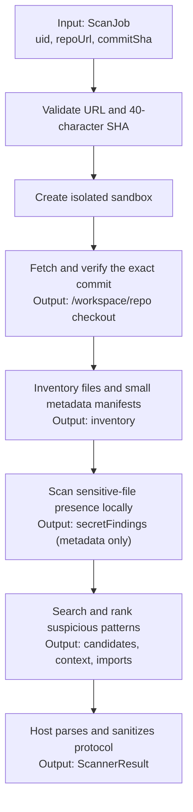
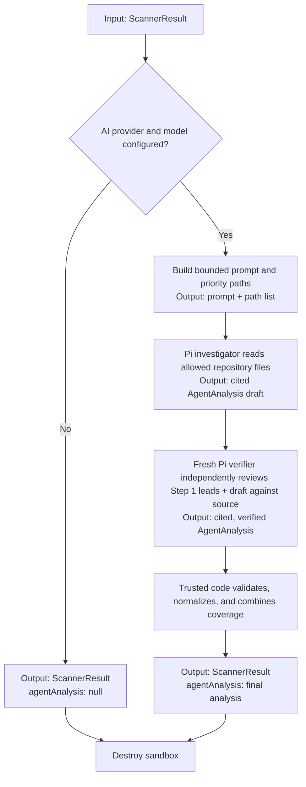

# CodeVet scan pipeline

A scan always targets one validated GitHub commit. Repository content is treated as **data**: neither step runs repository code, installs dependencies, builds, or tests it.

## Step 1: Flow

Step 1 is a deterministic scan in an isolated Railway sandbox. It creates the baseline `ScannerResult`; it does not make final vulnerability claims from regex matches.



### What happens at each point

| Point | What happens | Output / object |
|---|---|---|
| Input | Receives `uid`, canonical GitHub clone URL, and commit SHA. | `ScanJob` |
| Validation | Rejects non-HTTPS GitHub URLs, credentials/query strings, and invalid SHAs. | Validated URL and lowercase SHA |
| Checkout | Fetches only the requested SHA, checks it out detached, and verifies `HEAD`. Git hooks, submodules, LFS smudging, and credentials are disabled. | Read-only scan workspace at `/workspace/repo` |
| Inventory | Counts paths and reads limited project manifests to infer languages, package managers, frameworks, and entrypoints. | `inventory` |
| Secret presence | Looks only at conventional secret files. Secret values and file contents never leave the sandbox. | `secretFindings`: path, line, type, HMAC fingerprint |
| Discovery | Searches source/config files for behavior and security leads, then retains bounded line context and local import relationships. A match is a lead, not a finding. | `candidates`, `behaviors`, `networkCalls`, `candidateFlows`, `imports`, `snippets` |
| Parse and analyze | The host accepts only recognized `CODEVET_*` records, applies bounds/redaction, and derives structured evidence. | `ScannerResult` with `agentAnalysis: null` initially |

`ScannerResult` is the handoff object for Step 2:

```ts
{
  commitSha,
  inventory,
  candidates,        // ranked static-search leads
  secretFindings,    // metadata only; omitted from AI input
  securityFindings,
  behaviors,
  networkCalls,
  candidateFlows,    // possible, not proven, sensitive-data flows
  imports,
  snippets,
  findings,          // compatibility alias for securityFindings
  agentAnalysis: null
}
```

The sandbox is retained only for Step 2, then destroyed in all cases.

## Step 2: Flow

Step 2 is optional AI enrichment. It runs only when an AI provider key **and** model are configured. It uses the same checkout but a separate, cleared environment and read-only tools.



### What happens at each point

| Point | What happens | Output / object |
|---|---|---|
| Configuration check | Determines whether the provider API key and explicit model are available. | Skip, or AI configuration |
| Prompt build | Converts Step 1 metadata and ranked leads into a capped prompt. Sensitive-file findings and deterministic findings are excluded. | Prompt text and prioritized file paths |
| Investigator | Pi inspects allowed files with `read`, `grep`, `find`, and `ls`; it must submit one report through `codevet_report`, with exact source evidence for every finding. | Investigator `AgentAnalysis` draft |
| Verifier | A new Pi session receives the bounded Step 1 prompt/leads and investigator draft. Its preloaded-file priorities put investigator citations first, then Step 1 leads. It independently reviews priority paths, entrypoints, auth/request handling, and the draft's claims against the checkout. | Verified `AgentAnalysis` |
| Validation | Trusted sandbox code checks report paths and line ranges against readable checkout files, injects redacted source excerpts for citations, and enforces report bounds. Host code validates JSON shape and output size, deduplicates findings, normalizes contradictory verdict/risk values, and combines trusted coverage from both passes. Invalid, timed-out, or failed AI work becomes a non-fatal result. | `AgentAnalysis` with `completed`, `failed`, or `timeout` status |
| Final result | Adds the verified analysis to the deterministic Step 1 result. If the investigator does not complete, the verifier is not run. | `ScannerResult { ...step1, agentAnalysis }` |

`agentAnalysis` contains a scoped verdict, risk, summary, trusted coverage (the union of both passes), suspicious behaviors, high/critical security issues, external services, notes, and an optional error. Findings require exact, checkout-validated evidence ranges; their source excerpts are injected by trusted code. It is `null` only when Step 2 was deliberately skipped; Step 1 evidence is still returned if either AI pass fails.

## Step 1: Configurable Limits

Step 1 limits protect the sandbox and the host protocol. Only the scanner timeout is environment-configurable; all other limits are fixed safety caps in `src/checks/limits.ts`.

| Control | Default | Maximum | Effect |
|---|---:|---:|---|
| `CODEVET_SCANNER_TIMEOUT_SEC` | 600 seconds | 900 seconds | Stops the deterministic scan |
| Sandbox output | 128 MB | fixed | Rejects excessive protocol output |
| Path inventory | 100,000 paths | fixed | Caps emitted paths |
| Metadata manifests | 100 × 20 KB | fixed | Caps manifest data sent to the host |
| Sensitive-file scan | 10,000 findings; 1 MB/file | fixed | Caps local secret-presence scanning |
| Discovery | 5 MB/file; 180 leads/category | fixed | Caps pattern-search input and leads |
| Selected context | 120 candidates; 40/category; ±3 lines | fixed | Caps evidence returned from source |

Environment values may lower the timeout or raise it only up to its listed maximum.

## Step 2: Configurable Limits

Step 2 has configurable process limits plus fixed tool and model-inspection budgets. Both the investigator and verifier run under these budgets independently.

| Control | Default | Maximum | Effect |
|---|---:|---:|---|
| `CODEVET_AI_TIMEOUT_SEC` | 900 seconds | 1,200 seconds | Per-Pi-pass timeout |
| `CODEVET_AI_MAX_OUTPUT_BYTES` | 256 KB | 256 KB | Per-pass process/report output cap |
| Prompt | 64 KB | fixed | Limits Step 1 evidence sent to Pi |
| Preloaded context | 8 files / 256 KB | fixed | Initial source context only |
| File reads | 200 KB/file; 20 MB total | fixed | Limits model-visible repository content |
| Tool use | 200 calls; 100 LLM turns | fixed | Limits AI inspection work |
| Directory listing | 250 results | fixed | Limits `find`/`ls` output |
| Grep | 200 matches / 32 KB per call | fixed | Limits redacted search results |

Pi may access only existing, non-sensitive, non-generated files below `/workspace/repo`. It cannot use write or execution tools, read `.git` or conventional secret/key/certificate files, follow escaping symlinks, load extensions/skills/prompt templates, or run repository code. Source returned by its tools and trusted citation excerpts is redacted before reaching the model/provider.
